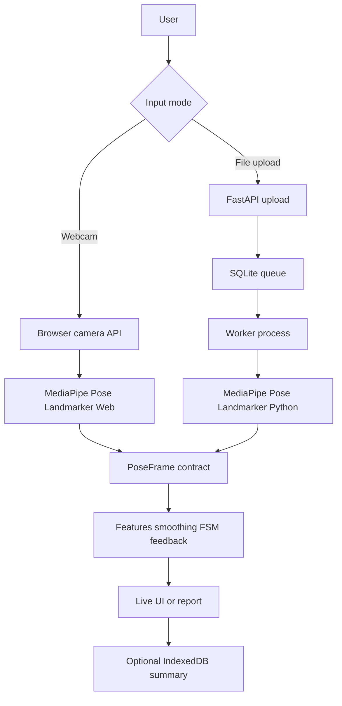

# Arquitetura alvo

Estado em 2026-10-17: fundação, cinemática e FSM das Ondas 0–2 implementadas. O layout completo
abaixo continua sendo o alvo das ondas. Hoje existem `motioncoach/contracts`,
`backend/app/main.py`, testes Python, `shared/schemas`, fixtures de contratos
e o shell Next.js. A geometria, EMA e quality gate vivem em
`frontend/features/exercise-engine`, junto às FSMs dos quatro exercícios.
Os algoritmos Python, worker, pesquisa e captura nascem nas ondas responsáveis.

## Fronteiras

| Caminho | Responsabilidade |
| --- | --- |
| `shared/` | JSON Schema, configuração de exercício e fixtures. Fonte normativa. |
| `frontend/` | Páginas, webcam, overlay, sessão local e a implementação TypeScript das regras. |
| `motioncoach/` | Contratos Python e, a partir da Onda 5, o mesmo motor e o acesso a vídeo. |
| `backend/` | HTTP, validação de upload, SQLite e ciclo de jobs. Sem geometria. |
| `research/` | Protocolos, resultados medidos e figuras. Sem número inventado. |

A webcam usa `@mediapipe/tasks-vision` no navegador. O upload usa MediaPipe
Tasks no Python, dentro de `motioncoach/`, chamado pelo worker. Os dois lados
consomem a mesma configuração.



## Layout alvo

```text
motioncoach-human-motion-analysis/
├── AGENTS.md
├── README.md
├── pyproject.toml
├── frontend/
│   ├── app/
│   ├── components/
│   ├── features/
│   │   ├── pose-engine/
│   │   ├── exercise-engine/
│   │   ├── session-store/
│   │   └── upload/
│   ├── workers/
│   └── tests/
├── motioncoach/
│   ├── contracts/
│   ├── geometry/
│   ├── temporal/
│   ├── quality/
│   ├── exercises/
│   ├── pose/
│   ├── video/
│   ├── pipeline/
│   └── tests/
├── backend/
│   ├── app/
│   │   ├── api/
│   │   ├── schemas/
│   │   ├── services/
│   │   ├── jobs/
│   │   └── core/
│   └── tests/
├── shared/
│   ├── schemas/
│   ├── exercise-configs/
│   └── fixtures/
├── research/
├── docs/
│   └── agentic/
├── scripts/
└── .github/workflows/
```

Vídeo de pessoa, checkpoint, asset `.task` e banco local ficam fora do Git.

## Contratos

Os exemplos do escopo, seções 10.1 a 10.3, orientam o formato. A versão
executável 1.0.0 está em `shared/schemas/contracts.schema.json`, com adaptadores
Pydantic comparados estruturalmente e tipos TypeScript gerados. Os exemplos
abreviados ganham `schema_version` e metadados obrigatórios, conforme ADR-011.
Campos extras são recusados. Números precisam ser finitos; `null` significa
dado indisponível, não zero. Detalhes em [shared/schemas](../shared/schemas/README.md).

`PoseFrame` carrega `timestamp_ms` monotônico na sessão ao vivo e o tempo da
mídia no vídeo enviado. Também carrega modelo, variante, `pose_quality`,
landmarks usados e features anuláveis.

`SessionSummary` carrega exercício, origem (`webcam` ou `upload`), vista,
duração, repetições completas e incompletas, cobertura, versão do algoritmo,
variante do modelo e eventos. Evento tem `timestamp_ms`, `exercise`, `rule_id`
e `quality`.

Eventos de produto: `CAMERA_PERMISSION_DENIED`, `POSE_LOST`, `POSE_RECOVERED`,
`LOW_VISIBILITY`, `REP_STARTED`, `REP_COMPLETED`, `REP_INCOMPLETE`,
`RANGE_VARIATION_OBSERVED`, `FEEDBACK_ISSUED`, `SESSION_PAUSED`,
`SESSION_FINISHED`.

## Tempo e threads

No ao vivo, a inferência consome o frame mais recente e descarta atrasados.
Overlay usa `requestAnimationFrame`. Gráfico ao vivo não roda dentro do
callback de inferência. Worker é a primeira tentativa na Onda 3; se o runtime
do MediaPipe impedir, o fallback na main thread entra no ADR com throttling
explícito.

No upload, o timestamp vem do PTS do vídeo. Recorte não renumera o tempo de
origem. A política concreta de VFR fica na Onda 5.

## API

O contrato HTTP está em [api-contract.md](api-contract.md). A Onda 0 publica
somente `GET /api/health`, já implementado. Não existe rota de streaming de webcam.

## Interface

Rotas do escopo, seção 8.2. Inglês por padrão, chaves de mensagem estáveis,
tema escuro, azul controlado sobre navy, números tabulares nas métricas. Os
estados de tela da seção 8.6 são obrigatórios no fluxo que cada onda tocar:
`idle`, `requesting_permission`, `camera_denied`, `loading_model`,
`calibrating`, `ready`, `analyzing`, `paused`, `no_pose`, `low_confidence`,
`processing`, `completed`, `failed`, `cancelled`.

## O que esta arquitetura ainda não fixa

Hash do modelo, alfa da EMA, seeds calibradas, tolerância de paridade, limites
medidos de upload e o conjunto de avaliação. Esses itens têm onda dona no
[plano](implementation-plan.md) e pendência no
[registro de decisões](agentic/architecture-decisions.md).


## Fundação implementada

Next.js App Router, React, TypeScript, Tailwind e primitivo de botão local
compatível com shadcn/ui (Radix Slot). Tokens em `app/globals.css`, mensagens
em `messages/en.ts`. O navegador só controla seletores de exercício e estado
em memória; não há conexão UI→API, permissão de câmera ou armazenamento.

Oito rotas do escopo estão navegáveis. Sessões de qualquer ID mostram ausência
de dados; `demo` identifica o preview. Métricas são indisponíveis e os estados
nomeados são demonstrativos. Recharts entra com os gráficos na Onda 7.

Instalação e comandos reais estão no [README](../README.md). Health e
contratos têm testes Python; Vitest cobre contratos compartilhados, rotas,
navegação e recuperação dos estados. CI não baixa modelo nem vídeo.


## Cinemática implementada — Onda 1

O módulo `frontend/features/exercise-engine` não depende de React ou HTTP.
Consome parâmetros comuns compartilhados, landmarks e timestamp/relógio
injetado. Retorna features anuláveis, qualidade e flags de continuidade para a
futura FSM. Perda de pose, salto ou geometria necessária degenerada bloqueiam
uso da amostra; gap longo reinicia suavização e referência espacial.

A configuração comum tem schema que reutiliza os contratos da fundação.
Fixtures sintéticas de geometria, EMA, qualidade e pipeline ficam em `shared/`.
Essa camada foi complementada na Onda 2 pelas configurações executáveis e FSMs.
Regras de recuperação no ADR-012 e no
[README do motor](../frontend/features/exercise-engine/README.md).


## FSM e analisador de frames — Onda 2

Configurações de exercício e binding anatômico vivem em `shared/`. O executor
`createFeatureAnalyzer` avalia transições/dwell e emite eventos; o wrapper
`createExerciseAnalyzer` seleciona/fixa lado, extrai features dos landmarks e
combina qualidade, EMA, observações atuais e FSM. `feature-processor.ts`
compartilha o pipeline temporal com a API angular da Onda 1.

A repetição exige extremo e retorno estável com ciclo mínimo. Pausa e perda
invalidam o ciclo ativo; retorno de dados exige a posição inicial. Polichinelo
usa o mínimo dos dois ângulos atuais e abertura horizontal simultânea; a
memória da EMA não pode criar essa simultaneidade. Detalhes no ADR-013.

O módulo continua fora do React e sem câmera/HTTP. A UI recebe essa integração
na Onda 3. O bundler usa a raiz do monorepo para resolver JSONs compartilhados.
Fixtures de features e landmarks em `shared/fixtures/repetitions/` prepararam a
regressão para o port Python; não substituem a paridade exigida na Onda 5.
